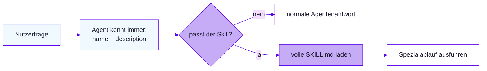
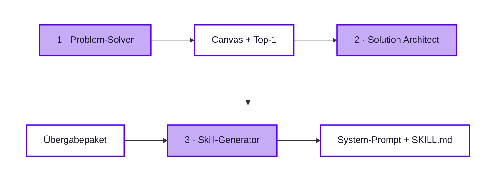

<div class="w-full text-center">

<h1 class="cover-title-normal">Chat-Agent &<br>The Nextise Agentic Way</h1>

S04 · Agent, Skill, Agentic Loop · Nordwind IT-Helfer · Drei-Assistenten-Kette

</div>

<style>
.cover-title-normal {
  font-weight: 400 !important;
  font-size: 2.1rem !important;
}
.slidev-layout.cover .prose p {
  font-weight: 400 !important;
  font-size: 1.25rem !important;
  opacity: 0.75;
  margin-top: 0.5rem !important;
}
</style>

---
layout: theory
title: 'Recap Tag 1 · Governance in drei Fragen'
---

<ul class="list-chevron space-y-2">
  <li><strong>Oversharing:</strong> Warum macht Copilot bestehende Berechtigungsfehler sichtbar?</li>
  <li><strong>Schutz:</strong> Welche Rolle spielen Labels, DLP und Conditional Access?</li>
  <li><strong>Agenten:</strong> Was steht im Governance-Blatt aus Lab 4.1?</li>
</ul>

<p class="text-sm opacity-70 mt-4">Erst kurz allein beantworten, dann mit Nachbar:in abgleichen.</p>

---
layout: agenda
title: 'Inhaltsverzeichnis'
---

<ul class="list-none pl-0 space-y-3 max-w-4xl mx-auto text-left">
  <li>
    <strong>Modul 6</strong> · Agenten verstehen & erster Chat-Agent
    <ul class="list-none pl-4 mt-1 space-y-0.5">
      <li>Lab 6.1 · Agent, Skill, Agentic Loop</li>
      <li>Lab 6.2 · Copilot Chat & Agent Builder</li>
      <li>Lab 6.3 · Ersten Chat-Agenten bauen</li>
    </ul>
  </li>
  <li>
    <strong>Modul 7</strong> · The Nextise Agentic Way
    <ul class="list-none pl-4 mt-1 space-y-0.5">
      <li>Lab 7.1 · Assistent 1: Problem-Solver</li>
      <li>Lab 7.2 · Assistent 2: Solution Architect</li>
      <li>Lab 7.3 · Assistent 3: Skill-Generator</li>
      <li>Lab 7.4 · Direktbau vs. Kette</li>
    </ul>
  </li>
</ul>

---
layout: section-divider
title: 'Modul 6: Agenten verstehen & erster Chat-Agent'
---

---
layout: theory
title: 'Lab 6.1 · Agent, Skill, Agentic Loop'
---

<ul class="list-chevron space-y-3">
  <li>Was macht einen Agenten mehr als einen gespeicherten Prompt?</li>
  <li>Wann Skill, wann Instruktion, wann Tool?</li>
  <li>Wann ist bewusst kein Agent sinnvoll?</li>
</ul>

---
layout: theory
title: 'Lab 6.1 · Agent, Skill, Agentic Loop'
---

<div class="qa-block"><p class="qa-q">Was macht einen Agenten mehr als einen gespeicherten Prompt?</p><ul class="qa-a"><li>Ein Agent besitzt einen dauerhaften Auftrag und konfigurierbare Bausteine. Ein Prompt bleibt eine einzelne Texteingabe ohne eigene Laufzeitstruktur.</li></ul></div>

<div class="qa-block"><p class="qa-q">Wann Skill, wann Instruktion, wann Tool?</p><ul class="qa-a"><li>Instruktionen steuern das Grundverhalten, Skills kapseln wiederverwendbares Vorgehen, Tools führen Aktionen in Systemen aus.</li></ul></div>

<div class="qa-block"><p class="qa-q">Wann ist bewusst kein Agent sinnvoll?</p><ul class="qa-a"><li>Einzelfälle mit hohem Ermessen, fehlender Datenbasis oder sensibler Verantwortung bleiben beim Menschen oder bei einem einmaligen Prompt.</li></ul></div>

<style>
.qa-block { margin: 0 0 0.55rem !important; }
.qa-block .qa-q { font-size: 0.95rem !important; margin: 0 0 0.2rem !important; }
.qa-block .qa-a, .qa-block .qa-a li { font-size: 0.85rem !important; line-height: 1.4 !important; }
</style>

---
layout: definition
title: 'Grundbegriffe für Agenten'
terms: [
  { term: 'Prompt', description: 'einmalige Eingabe für eine konkrete Antwort oder einen Entwurf' },
  { term: 'Chat', description: 'Verlauf mit Kontext, Rückfragen und iterativer Verfeinerung' },
  { term: 'Agent', description: 'wiederverwendbare Konfiguration für einen wiederkehrenden Auftrag' },
  { term: 'Skill', description: 'SKILL.md mit Name, Beschreibung und Markdown-Anweisungen' },
  { term: 'Tool', description: 'angebundene Aktion oder Systemfunktion, z. B. Workflow oder Connector' },
]
---

---
layout: comparison
title: 'Prompt, Chat oder Agent?'
leftLabel: 'Einmalig'
rightLabel: 'Wiederverwendbar'
---

::left::

<div class="space-y-3 text-sm leading-relaxed">
  <p><strong>Reiner Prompt:</strong> schnelle Formulierung, Zusammenfassung oder Ideenskizze.</p>
  <p><strong>Chat mit Verlauf:</strong> Rückfragen und Verfeinerung im Gespräch.</p>
  <p class="opacity-70">Grenze: keine dauerhafte Struktur und keine gemeinsame Agentenlogik.</p>
</div>

::right::

<div class="space-y-3 text-sm leading-relaxed">
  <p><strong>Chat-Agent:</strong> wiederkehrende Auskunft mit Regeln und Wissen.</p>
  <p><strong>Agent mit Tools/Skills:</strong> mehrstufige Aufgaben, Eskalation und strukturierte Teilprozesse.</p>
  <p class="opacity-70">Grenze: Pflege, Tests und klare Auslösebedingungen werden Pflicht.</p>
</div>

---
layout: code-terminal
title: 'Headset-Anfrage · drei Ausbaustufen'
language: 'txt'
---

::code::

```txt
Eingabe:
Ich brauche ein Headset für Teams-
Besprechungen. Was ist bei Nordwind vorgesehen?
```

::output::

```txt
Prompt: "Bei der IT nachfragen." (generisch)
Chat-Agent + Wissen: NW-HEADSET-USB,
Status verfügbar, Team IT-Support.
Agent + Skill/Tool: Antragsentwurf
vorbereitet; Ticket wartet auf Freigabe.
```

---
layout: theory
title: 'Übung Lab 6.1 · Aufgaben einordnen'
---

<ol class="exercise-tasks">
  <li>Sechs Nordwind-Aufgaben einordnen: Prompt, Chat-Agent, Tools/Skills oder kein Agent</li>
  <li>Je Aufgabe zwei Kriterien nennen</li>
  <li>Benötigten Baustein notieren</li>
</ol>

<p class="mt-6 mb-2 font-semibold" style="color: var(--kd-primary)">Am Ende habt ihr</p>

<ul class="list-chevron space-y-1">
  <li>Ausgefüllte Einordnungsmatrix</li>
  <li>Mindestens eine Aufgabe bewusst ohne Agent</li>
</ul>

<style>
.exercise-tasks > li { font-size: 1.1rem; line-height: 1.4; margin-bottom: 0.45rem; }
</style>

---
layout: theory
title: 'Lab 6.2 · Copilot Chat & Agent Builder'
---

<ul class="list-chevron space-y-3">
  <li>Welche UI-Elemente sind für Agenten relevant?</li>
  <li>Worin unterscheiden sich Copilot Chat und Microsoft 365 Copilot?</li>
</ul>

---
layout: theory
title: 'Lab 6.2 · Copilot Chat & Agent Builder'
---

<div class="qa-block"><p class="qa-q">Welche UI-Elemente sind für Agenten relevant?</p><ul class="qa-a"><li>Relevant sind Chat-Modus Arbeit/Web, Agentenbereich, Agent erstellen, Verlauf und Eingabefeld mit Anhängen.</li></ul></div>

<div class="qa-block"><p class="qa-q">Worin unterscheiden sich Copilot Chat und Microsoft 365 Copilot?</p><ul class="qa-a"><li>Copilot Chat ist der Chat-Einstieg; Microsoft 365 Copilot beschreibt den lizenzierten Arbeitskontext in M365-Apps und Arbeitsdaten.</li></ul></div>

<style>
.qa-block { margin: 0 0 0.55rem !important; }
.qa-block .qa-q { font-size: 0.95rem !important; margin: 0 0 0.2rem !important; }
.qa-block .qa-a, .qa-block .qa-a li { font-size: 0.85rem !important; line-height: 1.4 !important; }
</style>

---
layout: process-steps
title: 'Trainer-Demo: worauf ihr achtet'
steps: [
  { title: '1. Neuer Chat', description: 'Kontext startet leer; Verlauf wird bewusst beobachtet.' },
  { title: '2. Arbeit/Web', description: 'Datenreichweite hängt von Modus, Lizenz und Berechtigung ab.' },
  { title: '3. Agents/Agenten', description: 'Vorhandene und angeheftete Agenten werden sichtbar.' },
  { title: '4. Agent erstellen', description: 'Builder-Einstieg markieren; Position vor Kurs im Tenant prüfen.' },
]
---

<style>
.process-steps .mb-8 { margin-bottom: 0.7rem !important; }
.process-steps h4 { font-size: 16px !important; }
.process-steps .text-\[15px\] { font-size: 13px !important; }
</style>

---
layout: comparison
title: 'Copilot Chat vs. M365 Copilot'
leftLabel: 'Copilot Chat'
rightLabel: 'Microsoft 365 Copilot'
---

::left::

<ul class="space-y-2 text-sm list-disc pl-5">
  <li>Eigenständiger Chat in Web, App oder Teams-Kontext.</li>
  <li>Datenbasis: Web, Anhänge und je nach Modus Arbeitsdaten.</li>
  <li>Kursbezug: Startpunkt für Lab 6.3.</li>
</ul>

::right::

<ul class="space-y-2 text-sm list-disc pl-5">
  <li>Copilot-Funktionen in M365-Apps und Arbeitsdaten.</li>
  <li>Datenbasis: Dateien, Mails, Chats, Kalender nach Berechtigung.</li>
  <li>Risiko: scheinbar vollständiger Kontext trotz fehlender Rechte.</li>
</ul>

---
layout: theory
title: 'Übung Lab 6.2 · Copilot Chat beobachten'
---

<ol class="exercise-tasks">
  <li>Drei UI-Elemente mit Zweck notieren</li>
  <li>Einstieg „Agent erstellen“ markieren</li>
  <li>Unterschied Arbeit/Web festhalten</li>
</ol>

<p class="mt-6 mb-2 font-semibold" style="color: var(--kd-primary)">Am Ende habt ihr</p>

<ul class="list-chevron space-y-1">
  <li>Beobachtungsblatt mit dem Einstieg für Lab 6.3</li>
</ul>

<style>
.exercise-tasks > li { font-size: 1.1rem; line-height: 1.4; margin-bottom: 0.45rem; }
</style>

---
layout: theory
title: 'Lab 6.3 · Ersten Chat-Agenten bauen'
---

<ul class="list-chevron space-y-3">
  <li>Welche drei Angaben braucht ein Agent mindestens?</li>
  <li>Woran erkennt man fehlendes Firmenwissen?</li>
  <li>Was unterscheidet Beschreiben und Konfigurieren?</li>
</ul>

---
layout: theory
title: 'Lab 6.3 · Ersten Chat-Agenten bauen'
---

<div class="qa-block"><p class="qa-q">Welche drei Angaben braucht ein Agent mindestens?</p><ul class="qa-a"><li>Name, Beschreibung und Instruktionen reichen für einen ersten Test. Für belastbare Fachantworten kommt später Wissen hinzu.</li></ul></div>

<div class="qa-block"><p class="qa-q">Woran erkennt man fehlendes Firmenwissen?</p><ul class="qa-a"><li>Antworten bleiben allgemein, raten Details oder eskalieren nicht sauber. Ein Testlog macht diese Schwächen sichtbar.</li></ul></div>

<div class="qa-block"><p class="qa-q">Was unterscheidet Beschreiben und Konfigurieren?</p><ul class="qa-a"><li>Beschreiben startet natürlichsprachlich; Konfigurieren macht Felder, Regeln und Starter-Prompts explizit sichtbar.</li></ul></div>

<style>
.qa-block { margin: 0 0 0.55rem !important; }
.qa-block .qa-q { font-size: 0.95rem !important; margin: 0 0 0.2rem !important; }
.qa-block .qa-a, .qa-block .qa-a li { font-size: 0.85rem !important; line-height: 1.4 !important; }
</style>

---
layout: definition
title: 'Felder im Agent Builder'
terms: [
  { term: 'Name', description: 'sichtbarer Agentenname, z. B. Nordwind IT-Helfer' },
  { term: 'Beschreibung', description: 'kurze Erwartung für Nutzende und Agentenauswahl' },
  { term: 'Instruktionen', description: 'Rolle, Umfang, Stil, Grenzen und Eskalation' },
  { term: 'Starter-Prompts', description: 'typische Einstiegsfragen für den Test' },
  { term: 'Wissen', description: 'in diesem Lab bewusst leer' },
]
---

---
layout: comparison
title: 'Beschreiben vs. Konfigurieren'
leftLabel: 'Beschreiben'
rightLabel: 'Konfigurieren'
---

::left::

<ul class="space-y-2 text-sm list-disc pl-5">
  <li>Schneller Start aus einer natürlichsprachlichen Idee.</li>
  <li>Gut für grobe Richtung und ersten Entwurf.</li>
  <li>Risiko: Grenzen bleiben implizit.</li>
</ul>

::right::

<ul class="space-y-2 text-sm list-disc pl-5">
  <li>Felder, Regeln und Starter-Prompts werden sichtbar.</li>
  <li>Gut für prüfbare Konfiguration.</li>
  <li>Risiko: mehr Sorgfalt beim Ausfüllen nötig.</li>
</ul>

---
layout: code-focus
title: 'Instruktionsskelett für Nordwind'
language: 'markdown'
---

Dieses Skelett ist die Kurzfassung und wird hier zur Verhaltens-Baseline.

::code::

```markdown
# Rolle: Nordwind IT-Helfer
# Grenzen: nur belegte Informationen
# Eskalation: IT/HR bei Sonderfällen
# Stil: kurz, sachlich, nächste Schritte
```

::notes::

- Wissen bleibt in Lab 6.3 absichtlich leer.
- Der Test prüft Verhalten, Stil und Grenzen.
- Fachantworten werden erst mit Wissensquellen (Lab 8.1) belastbar.

---
layout: theory
title: 'Testlog als Baseline'
---

<div style="font-size: 0.82rem">

| Testfrage | Erwartung ohne Wissen | Schwäche | Nacharbeit |
| --- | --- | --- | --- |
| „Wie lang muss ein Passwort sein?“ | allgemeine Empfehlung | Firmenregel fehlt | Wissen ergänzen |
| „Welches Headset ist Standard?“ | rät ein Modell | keine Geräteliste | Wissen ergänzen |
| „Ausnahme von der MFA-Pflicht?“ | sagt „IT fragen“ | Grenze unscharf | Instruktion schärfen |

</div>

---
layout: theory
title: 'Übung Lab 6.3 · Nordwind IT-Helfer bauen'
---

<ol class="exercise-tasks">
  <li>Agent Builder öffnen, Instruktionsskelett einsetzen</li>
  <li>Name, Beschreibung und zwei Starter-Prompts ergänzen</li>
  <li>Ohne Wissensquelle die drei Testfragen stellen</li>
  <li>Testlog sichern</li>
</ol>

<p class="mt-6 mb-2 font-semibold" style="color: var(--kd-primary)">Am Ende habt ihr</p>

<ul class="list-chevron space-y-1">
  <li>Ersten eigenen Chat-Agenten</li>
  <li>Testlog mit sichtbaren Wissenslücken – Basis für Lab 8.1</li>
</ul>

<style>
.exercise-tasks > li { font-size: 1.1rem; line-height: 1.4; margin-bottom: 0.45rem; }
</style>

---
layout: section-divider
title: 'Modul 7: The Nextise Agentic Way'
---

---
layout: theory
title: 'Lab 7.1 · Assistent 1: Problem-Solver'
---

<ul class="list-chevron space-y-3">
  <li>Warum liefert der Problem-Solver noch keine fertige Lösung?</li>
  <li>Welche Ausgabe macht den nächsten Schritt möglich?</li>
</ul>

---
layout: theory
title: 'Lab 7.1 · Assistent 1: Problem-Solver'
---

<div class="qa-block"><p class="qa-q">Warum liefert der Problem-Solver noch keine fertige Lösung?</p><ul class="qa-a"><li>Weil zuerst Problem, Zielgruppe, Nutzen, Datenlage und Risiken belastbar sein müssen. Eine Lösung ohne Problemklarheit optimiert oft das Falsche.</li></ul></div>

<div class="qa-block"><p class="qa-q">Welche Ausgabe macht den nächsten Schritt möglich?</p><ul class="qa-a"><li>Ein vollständiger Use-Case-Canvas, ein Scoring und eine Top-1-Empfehlung reichen für den Solution Architect.</li></ul></div>

<style>
.qa-block { margin: 0 0 0.55rem !important; }
.qa-block .qa-q { font-size: 0.95rem !important; margin: 0 0 0.2rem !important; }
.qa-block .qa-a, .qa-block .qa-a li { font-size: 0.85rem !important; line-height: 1.4 !important; }
</style>

---
layout: process-steps
title: 'Assistent 1: vom Problem zur Top-1'
steps: [
  { title: 'Input', description: 'Nordwind-Testlog, Zielgruppe, Ist-Prozess, Nutzenwunsch und bekannte Grenzen.' },
  { title: 'Canvas', description: 'Problem, Zielgruppe, Ist-/Soll-Prozess, Nutzen, Datenquellen und Risiken.' },
  { title: 'Scoring', description: 'Business-Nutzen, Aufwand, Datenverfügbarkeit und Governance-Risiko bewerten.' },
  { title: 'Output', description: 'Top-1-Empfehlung plus drei nächste Validierungsschritte.' },
]
---

<style>
.process-steps .mb-8 { margin-bottom: 0.7rem !important; }
.process-steps h4 { font-size: 16px !important; }
.process-steps .text-\[15px\] { font-size: 13px !important; }
</style>

---
layout: key-points
title: 'Canvas: sieben Felder'
columns: 2
---

<div class="key-card"><h3>Problem</h3><ul><li>wiederkehrender Schmerz statt Toolwunsch.</li></ul></div>
<div class="key-card"><h3>Zielgruppe</h3><ul><li>betroffene Personen und Nutzungskontext.</li></ul></div>
<div class="key-card"><h3>Ist- und Soll-Prozess</h3><ul><li>heutige Arbeit und gewünschter Ablauf.</li></ul></div>
<div class="key-card"><h3>Nutzen & Risiken</h3><ul><li>messbare Veränderung, Quellen, Datenschutz, Qualität.</li></ul></div>

---
layout: code-compare
title: 'Problem-Solver · Headset-Fall'
leftLabel: 'Eingabe'
rightLabel: 'Typische Ausgabe'
leftLanguage: 'txt'
rightLanguage: 'txt'
---

::left::

```txt
Eingabe:
Wiederkehrende Fragen zu Headsets.
Quelle: IT-Geräte mit NW-HEADSET-USB,
Status verfügbar, Team IT-Support.
Keine automatische Bestellung.
```

::right::

```txt
Canvas: Anfragen landen verteilt bei
Mitarbeitenden und IT.
Soll: Standardgerät nennen,
IT-Anfrage vorbereiten.
Risiko: Bestand/Freigabe unklar.
Top-1: Headset-Anfrage vorbereiten.
```

---
layout: theory
title: 'Übung Lab 7.1 · Problem-Solver einsetzen'
---

<ol class="exercise-tasks">
  <li>Assistent 1 aus der Kopiervorlage anlegen</li>
  <li>Nordwind-Supportproblem schildern</li>
  <li>Rückfragen beantworten</li>
</ol>

<p class="mt-6 mb-2 font-semibold" style="color: var(--kd-primary)">Am Ende habt ihr</p>

<ul class="list-chevron space-y-1">
  <li>Use-Case-Canvas mit Scoring</li>
  <li>Eine Top-1-Empfehlung für Lab 7.2</li>
</ul>

<style>
.exercise-tasks > li { font-size: 1.1rem; line-height: 1.4; margin-bottom: 0.45rem; }
</style>

---
layout: theory
title: 'Lab 7.2 · Assistent 2: Solution Architect'
---

<ul class="list-chevron space-y-3">
  <li>Wie viele Skills sind für einen wartbaren Agenten realistisch?</li>
  <li>Warum gehören Skill-Details nicht in den System-Prompt?</li>
</ul>

---
layout: theory
title: 'Lab 7.2 · Assistent 2: Solution Architect'
---

<div class="qa-block"><p class="qa-q">Wie viele Skills sind für einen wartbaren Agenten realistisch?</p><ul class="qa-a"><li>Für eine erste Version reichen maximal fünf bis sechs prozessabhängige Skills. Mehr Skills erhöhen Test- und Pflegeaufwand.</li></ul></div>

<div class="qa-block"><p class="qa-q">Warum gehören Skill-Details nicht in den System-Prompt?</p><ul class="qa-a"><li>Der System-Prompt steuert Rolle und Grenzen. Skills kapseln spezialisierte Abläufe separat und bleiben dadurch testbarer.</li></ul></div>

<style>
.qa-block { margin: 0 0 0.55rem !important; }
.qa-block .qa-q { font-size: 0.95rem !important; margin: 0 0 0.2rem !important; }
.qa-block .qa-a, .qa-block .qa-a li { font-size: 0.85rem !important; line-height: 1.4 !important; }
</style>

---
layout: process-steps
title: 'Assistent 2: vom Canvas zum Bauplan'
steps: [
  { title: 'Input', description: 'Top-1-Empfehlung, Canvas, Scoring, Risiken und Erfolgskriterien.' },
  { title: 'Kurzkonzept', description: 'Zielbild, Zielgruppe, Scope, Nicht-Scope und Erfolgskriterien.' },
  { title: 'Bausteine', description: 'Maximal 5–6 Skills, Tool-Bedarf, Wissen, Human-in-the-loop und Tests.' },
  { title: 'Output', description: 'Ablauf und Übergabepaket für Prompt- und Skill-Erstellung.' },
]
---

<style>
.process-steps .mb-8 { margin-bottom: 0.7rem !important; }
.process-steps h4 { font-size: 16px !important; }
.process-steps .text-\[15px\] { font-size: 13px !important; }
</style>

---
layout: comparison
title: 'Tools, Skills und Knowledge trennen'
leftLabel: 'Skill / Knowledge'
rightLabel: 'Tool'
---

::left::

<ul class="space-y-2 text-sm list-disc pl-5">
  <li><strong>Skill:</strong> wiederholbarer Ablauf, z. B. Checkliste erstellen.</li>
  <li><strong>Knowledge:</strong> Quelle für Fakten, z. B. Richtlinie oder Leitfaden.</li>
  <li>Beide bleiben prüfbar und versionierbar.</li>
</ul>

::right::

<ul class="space-y-2 text-sm list-disc pl-5">
  <li><strong>Tool:</strong> Aktion in einem System.</li>
  <li>Beispiele: Ticket erstellen, Status lesen, Genehmigung starten.</li>
  <li>Schreibende Tools brauchen klare Freigabe.</li>
</ul>

---
layout: code-compare
title: 'Solution Architect · Headset-Top-1'
leftLabel: 'Input'
rightLabel: 'Typische Ausgabe'
leftLanguage: 'txt'
rightLanguage: 'txt'
---

::left::

```txt
Top-1:
Headset-Anfrage vorbereiten,
nicht automatisch bestellen.
Quelle: IT-Geräte, NW-HEADSET-USB.
Grenze: keine Bestandsgarantie,
keine Bestellung auslösen.
```

::right::

```txt
Kurzkonzept: kleiner Headset-Helfer.
Skills:
- nordwind-headset-anfrage-vorbereiten
- geraeteantwort-pruefen
- supportkontakt-formulieren
Übergabe: Ziel, Nicht-Scope,
Quelle, Tests, Freigaben.
```

---
layout: theory
title: 'Übung Lab 7.2 · Solution Architect einsetzen'
---

<ol class="exercise-tasks">
  <li>Assistent 2 anlegen, Ergebnis aus Lab 7.1 einfügen</li>
  <li>Kurzkonzept erzeugen lassen</li>
  <li>Einen Skill für Lab 7.3 auswählen</li>
</ol>

<p class="mt-6 mb-2 font-semibold" style="color: var(--kd-primary)">Am Ende habt ihr</p>

<ul class="list-chevron space-y-1">
  <li>Kurzkonzept mit höchstens sechs Skills</li>
  <li>Übergabepaket mit genau einem gewählten Skill</li>
</ul>

<style>
.exercise-tasks > li { font-size: 1.1rem; line-height: 1.4; margin-bottom: 0.45rem; }
</style>

---
layout: theory
title: 'Lab 7.3 · Assistent 3: Skill-Generator'
---

<ul class="list-chevron space-y-3">
  <li>Was müsste vor produktiver Nutzung des System-Prompts geprüft werden?</li>
  <li>Warum entsteht zusätzlich zur Instruktion eine <code>SKILL.md</code>?</li>
</ul>

---
layout: theory
title: 'Lab 7.3 · Assistent 3: Skill-Generator'
---

<div class="qa-block"><p class="qa-q">Was müsste vor produktiver Nutzung des System-Prompts geprüft werden?</p><ul class="qa-a"><li>Quellen, Berechtigungen, Eskalationsregeln, Testfälle, Datenschutz und fachliche Freigabe müssen geprüft sein.</li></ul></div>

<div class="qa-block"><p class="qa-q">Warum entsteht zusätzlich zur Instruktion eine <code>SKILL.md</code>?</p><ul class="qa-a"><li>Der System-Prompt steuert den Agenten insgesamt. Die <code>SKILL.md</code> kapselt einen wiederholbaren Prozess separat.</li></ul></div>

<style>
.qa-block { margin: 0 0 0.55rem !important; }
.qa-block .qa-q { font-size: 0.95rem !important; margin: 0 0 0.2rem !important; }
.qa-block .qa-a, .qa-block .qa-a li { font-size: 0.85rem !important; line-height: 1.4 !important; }
</style>

---
layout: process-steps
title: 'Assistent 3: vom Bauplan zum Artefakt'
steps: [
  { title: 'Input', description: 'Übergabepaket, gewählter Skill, Datenquellen, Grenzen und Testfälle.' },
  { title: 'System-Prompt', description: 'Rolle, Ziel, Grenzen, Eingabeprüfung, Stil und Eskalation.' },
  { title: 'SKILL.md', description: 'Name, Beschreibung, Ablauf, Prüfungen, Sonderfälle und Ausgabeformat.' },
  { title: 'Output', description: 'Kopierbare Artefakte plus Testplan und offene Freigaben.' },
]
---

<style>
.process-steps .mb-8 { margin-bottom: 0.7rem !important; }
.process-steps h4 { font-size: 16px !important; }
.process-steps .text-\[15px\] { font-size: 13px !important; }
</style>

---
layout: code-focus
title: 'Beispiel: SKILL.md'
language: 'markdown'
---

Die Datei kapselt einen engen, wiederholbaren Prozess – nicht das ganze Agentenverhalten.

::code::

```markdown
---
name: nordwind-headset-anfrage-vorbereiten
description: Bereitet eine kurze Headset-Anfrage vor.
---
# Anweisungen: Geräteliste prüfen, Sonderfälle eskalieren.
```

::notes::

- `description` steuert, wann der Skill geladen wird.
- Markdown-Anweisungen bleiben lesbar und prüfbar.
- Sensible oder irreversible Schritte brauchen Freigabe.

---
layout: theory
title: 'Skill-Kontext nur bei Bedarf laden'
---



<p class="text-sm opacity-70 mt-4">Progressive Disclosure hält die Hauptinstruktion schlank: Erst bei passender Beschreibung wird der volle Skill-Kontext nachgeladen.</p>

---
layout: theory
title: 'Übung Lab 7.3 · System-Prompt und SKILL.md'
---

<ol class="exercise-tasks">
  <li>Assistent 3 anlegen, Übergabepaket einfügen</li>
  <li>System-Prompt und SKILL.md erzeugen lassen</li>
  <li>Mit der eigenen Instruktion aus Lab 6.3 vergleichen</li>
</ol>

<p class="mt-6 mb-2 font-semibold" style="color: var(--kd-primary)">Am Ende habt ihr</p>

<ul class="list-chevron space-y-1">
  <li>System-Prompt für den IT-Helfer</li>
  <li>Eine SKILL.md für den Studio-Agenten</li>
  <li>Drei Testfälle</li>
</ul>

<style>
.exercise-tasks > li { font-size: 1.1rem; line-height: 1.4; margin-bottom: 0.45rem; }
</style>

---
layout: theory
title: 'Lab 7.4 · The Nextise Agentic Way'
---

<ul class="list-chevron space-y-3">
  <li>Was ändert Problem-vor-Lösung am Ergebnis?</li>
  <li>Warum bleibt der Mensch in der Schleife?</li>
  <li>Warum gilt das Muster auch für Coding und Vibecoding?</li>
</ul>

---
layout: theory
title: 'Lab 7.4 · The Nextise Agentic Way'
---

<div class="qa-block"><p class="qa-q">Was ändert Problem-vor-Lösung am Ergebnis?</p><ul class="qa-a"><li>Der Agent bekommt klarere Grenzen, bessere Testfälle und weniger implizite Annahmen.</li></ul></div>

<div class="qa-block"><p class="qa-q">Warum bleibt der Mensch in der Schleife?</p><ul class="qa-a"><li>Priorisierung, Freigaben, Risikoabwägung und fachliche Verantwortung werden nicht an die KI abgegeben.</li></ul></div>

<div class="qa-block"><p class="qa-q">Warum gilt das Muster auch für Coding und Vibecoding?</p><ul class="qa-a"><li>Auch dort verbessert die Trennung von Problem, Architektur, Teilaufgabe, Test und Review die Ergebnisqualität.</li></ul></div>

<style>
.qa-block { margin: 0 0 0.55rem !important; }
.qa-block .qa-q { font-size: 0.95rem !important; margin: 0 0 0.2rem !important; }
.qa-block .qa-a, .qa-block .qa-a li { font-size: 0.85rem !important; line-height: 1.4 !important; }
</style>

---
layout: theory
title: 'Die Drei-Assistenten-Kette'
---



<p class="text-sm opacity-70 mt-4">Jeder Assistent liefert ein prüfbares Übergabeartefakt — und der Mensch entscheidet an jeder Kante weiter oder Stopp.</p>

---
layout: comparison
title: 'Direktbau vs. Kette'
leftLabel: 'Lab 6.3 direkt gebaut'
rightLabel: 'Lab 7.1–7.3 Kette'
---

::left::

<ul class="space-y-2 text-sm list-disc pl-5">
  <li>Schnell, aber tendenziell unscharf.</li>
  <li>Grenzen hängen an der ersten Formulierung.</li>
  <li>Testlog zeigt Schwächen erst nach dem Bau.</li>
</ul>

::right::

<ul class="space-y-2 text-sm list-disc pl-5">
  <li>Problem, Scope und Tests sind geschärft.</li>
  <li>Skills und Nicht-Scope bleiben bewusst begrenzt.</li>
  <li>Eskalation entsteht aus Risiko und Governance.</li>
</ul>

---
layout: code-compare
title: 'One-Shot vs. Kette · Headset-Agent'
leftLabel: 'One-Shot'
rightLabel: 'Kette'
leftLanguage: 'txt'
rightLanguage: 'txt'
---

::left::

```txt
Prompt:
Bau mir einen Headset-Agenten
für Nordwind.

Output: Name, Beschreibung,
allgemeine Antwortlogik.
Unscharf: Quelle, Stopppunkt,
Tests und Freigabe.
```

::right::

```txt
Canvas → Architect → Skill.

Output: begrenzter Scope,
Quelle IT-Geräte,
Stopppunkt vor Bestellung,
Skill-Kopf und drei Tests:
Normalfall, fehlende Angaben,
Bestellwunsch.
```

---
layout: theory
title: 'Übung Lab 7.4 · Direktbau vs. Kette'
---

<ol class="exercise-tasks">
  <li>Agent aus Lab 6.3 mit dem Kettenergebnis vergleichen</li>
  <li>Kriterien: Präzision, Scope, Eskalation, Testbarkeit</li>
  <li>Wichtigsten Schritt der Kette benennen</li>
</ol>

<p class="mt-6 mb-2 font-semibold" style="color: var(--kd-primary)">Am Ende habt ihr</p>

<ul class="list-chevron space-y-1">
  <li>Vergleichstabelle mit vier Kriterien</li>
  <li>Einen Satz: welcher Schritt am meisten verändert hat</li>
</ul>

<style>
.exercise-tasks > li { font-size: 1.1rem; line-height: 1.4; margin-bottom: 0.45rem; }
</style>

---
layout: key-points
title: 'Artefakte nach Modul 7'
columns: 3
---

<div class="key-card"><span class="iconify i-carbon-chat-bot" style="font-size: 1.5rem; color: var(--kd-primary)"></span><h3>Chat-Agent</h3><ul><li>Nordwind IT-Helfer ohne Wissen plus Testlog</li></ul></div>
<div class="key-card"><span class="iconify i-carbon-document" style="font-size: 1.5rem; color: var(--kd-primary)"></span><h3>System-Prompt</h3><ul><li>finale Regeln aus Assistent 3</li></ul></div>
<div class="key-card"><span class="iconify i-carbon-cube" style="font-size: 1.5rem; color: var(--kd-primary)"></span><h3>SKILL.md</h3><ul><li>Skill-Entwurf für den Studio-Agenten</li></ul></div>
