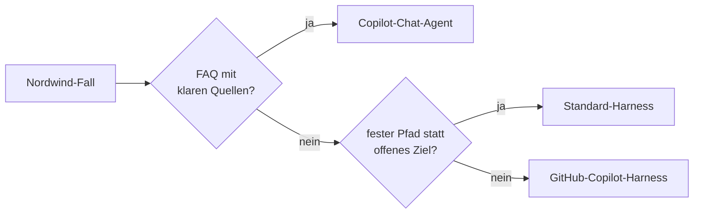
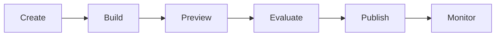

<div class="w-full text-center">

<h1 class="cover-title-normal">Optimieren &<br>Studio-Agent mit Skills</h1>

S05 · Wissensquellen · Chat vs. Studio · Studio-Agent · Skills

</div>

<style>
.cover-title-normal {
  font-weight: 400 !important;
  font-size: 2.1rem !important;
}
.slidev-layout.cover .prose p {
  font-weight: 400 !important;
  font-size: 1.25rem !important;
  opacity: 0.75;
  margin-top: 0.5rem !important;
}
/* carried */
.small-table table { font-size: 0.78rem; }
.compact-list li { margin-bottom: 0.25rem; }
</style>

---
layout: agenda
title: 'Inhaltsverzeichnis'
---

<ul class="list-none pl-0 space-y-3 max-w-4xl mx-auto text-left">
  <li>
    <strong>Modul 8</strong> · Optimieren & Studio-Agent
    <ul class="list-none pl-4 mt-1 space-y-0.5">
      <li>Lab 8.1 · Chat-Agent optimieren</li>
      <li>Lab 8.2 · Copilot Chat oder Copilot Studio?</li>
      <li>Lab 8.3 · Studio-Agent anlegen</li>
      <li>Lab 8.4 · Skills hinzufügen</li>
    </ul>
  </li>
</ul>

---
layout: section-divider
title: 'Modul 8: Optimieren & Studio-Agent'
---

---
layout: theory
title: 'Lab 8.1 · Chat-Agent optimieren'
---

<ul class="list-chevron space-y-2">
  <li>Wie zeigt sich, ob eine Antwort aus einer Wissensquelle stammt?</li>
  <li>Was gehört in Instruktionen und was gehört in Wissen?</li>
  <li>Was hat die Assistenten-Kette gegenüber dem direkten Bau verändert?</li>
</ul>

---
layout: theory
title: 'Lab 8.1 · Chat-Agent optimieren'
---

<div class="qa-block"><p class="qa-q">Wie zeigt sich, ob eine Antwort aus einer Wissensquelle stammt?</p><ul class="qa-a"><li>Sie nennt belegbare Details aus der Datei oder verweist sichtbar auf eine Quelle. Plausible, aber unbelegte Antworten bleiben kritisch.</li></ul></div>

<div class="qa-block"><p class="qa-q">Was gehört in Instruktionen und was gehört in Wissen?</p><ul class="qa-a"><li>Instruktionen steuern Rolle, Verhalten, Grenzen und Format. Wissen liefert Fakten, Richtlinien und Prozessdetails.</li></ul></div>

<div class="qa-block"><p class="qa-q">Was hat die Assistenten-Kette verändert?</p><ul class="qa-a"><li>Sie trennt Problemklärung, Lösungsentwurf und Prompt-/Skill-Formulierung. Dadurch entstehen klarere Regeln und testbare Erwartungen.</li></ul></div>

<style>
.qa-block { margin: 0 0 0.55rem !important; }
.qa-block .qa-q { font-size: 0.95rem !important; margin: 0 0 0.2rem !important; }
.qa-block .qa-a, .qa-block .qa-a li { font-size: 0.85rem !important; line-height: 1.4 !important; }
</style>

---
layout: theory
title: 'Bausteine im Agent Builder'
---

<div class="small-table">

| Baustein | Zweck | Nordwind-Beispiel |
| --- | --- | --- |
| Instruktionen | Verhalten, Ton, Grenzen | System-Prompt aus Lab 7.3 |
| Wissensquelle | überprüfbare Faktenbasis | IT-Richtlinie und Onboarding-Leitfaden |
| Testprotokoll | Beobachtung statt Bauchgefühl | drei bekannte plus zwei neue Fragen |
| Nachschärfung | gezielte Änderung nach Testfehler | Eskalationsregel oder Quellenhinweis |

</div>

<style>
.small-table table { font-size: 0.78rem; }
</style>

---
layout: content-left-right
title: 'Instruktion vs. Wissen'
---

::left::

<h3>Instruktionen</h3>
<ul class="list-chevron compact-list">
  <li>Rolle, Stil und Grenzen.</li>
  <li>Eskalation bei Sonderfällen.</li>
  <li>Ausgabeform und Tonalität.</li>
</ul>

::right::

<h3>Wissen</h3>
<ul class="list-chevron compact-list">
  <li>Richtlinienfakten und Prozesse.</li>
  <li>Pflegbare Dateien oder SharePoint.</li>
  <li>Quelle für belastbare Antworten.</li>
</ul>

<p class="text-sm opacity-70 mt-3">Fakten nicht in den Prompt kopieren, wenn sie als Quelle gepflegt werden.</p>

<style>
.compact-list li { margin-bottom: 0.25rem; }
</style>

---
layout: code-compare
title: 'Lab 8.1 · Grounding im Vergleich'
leftLabel: 'Testfrage'
rightLabel: 'Typische Ausgabe'
leftLanguage: 'txt'
rightLanguage: 'txt'
---

::left::

```txt
Welche Standardsoftware ist auf einem neuen
Nordwind-Firmengerät installiert?

Variante A:
Chat-Agent ohne Wissensquelle

Variante B:
optimierter Agent mit Onboarding-Leitfaden
und Bitte um Quellenhinweis
```

::right::

```txt
Ohne Wissen:
Übliche Office-Apps, Teams, Browser,
Sicherheitssoftware. Genaue Ausstattung
bitte bei der IT prüfen.

Mit Wissen:
Onboarding-Leitfaden, Standard-Software:
Microsoft 365 Apps inkl. Copilot,
Cisco Secure Client, Teams,
Antivirus/Endpoint-Schutz.
```

---
layout: theory
title: 'Übung Lab 8.1 · Chat-Agent optimieren'
---

<ol class="exercise-tasks">
  <li>System-Prompt aus Lab 7.3 übernehmen</li>
  <li>IT-Richtlinie und Onboarding-Leitfaden als Wissen hinzufügen</li>
  <li>Testfragen aus Lab 6.3 plus zwei neue stellen</li>
  <li>Vorher/Nachher notieren</li>
</ol>

<p class="mt-6 mb-2 font-semibold" style="color: var(--kd-primary)">Am Ende habt ihr</p>

<ul class="list-chevron space-y-1">
  <li>Optimierten IT-Helfer mit Wissensquellen</li>
  <li>Vorher/Nachher-Tabelle mit fünf Fragen</li>
</ul>

<style>
.exercise-tasks > li { font-size: 1.1rem; line-height: 1.4; margin-bottom: 0.45rem; }
</style>

---
layout: theory
title: 'Lab 8.2 · Copilot Chat oder Copilot Studio?'
---

<ul class="list-chevron space-y-2">
  <li>Wann reicht ein Copilot-Chat-Agent?</li>
  <li>Wann lohnt der GitHub-Copilot-Harness trotz Credits?</li>
  <li>Warum ist der stärkere Harness nicht automatisch besser?</li>
</ul>

---
layout: theory
title: 'Lab 8.2 · Copilot Chat oder Copilot Studio?'
---

<div class="qa-block"><p class="qa-q">Wann reicht ein Copilot-Chat-Agent?</p><ul class="qa-a"><li>Wenn interne Wissensfragen mit klaren Quellen im Vordergrund stehen und keine mehrstufige Tool-, Datei- oder Workflow-Orchestrierung nötig ist.</li></ul></div>

<div class="qa-block"><p class="qa-q">Wann lohnt der GitHub-Copilot-Harness trotz Credits?</p><ul class="qa-a"><li>Wenn ein offenes Ziel, mehrere Schritte, Skills, Memory, Dateien oder dynamische Fehlerbehandlung gebraucht werden.</li></ul></div>

<div class="qa-block"><p class="qa-q">Warum ist der stärkere Harness nicht automatisch besser?</p><ul class="qa-a"><li>Mehr Fähigkeiten bedeuten auch mehr Credits, Latenz und Konfigurationsaufwand. Ohne Mehrwert wird die Lösung überarbeitet.</li></ul></div>

<style>
.qa-block { margin: 0 0 0.55rem !important; }
.qa-block .qa-q { font-size: 0.95rem !important; margin: 0 0 0.2rem !important; }
.qa-block .qa-a, .qa-block .qa-a li { font-size: 0.85rem !important; line-height: 1.4 !important; }
</style>

---
layout: key-points
title: 'Drei Wege im Vergleich'
columns: 3
---

<div class="key-card"><h3>Copilot-Chat-Agent</h3><ul><li>Interne Wissensfragen</li><li>Schnell starten</li><li>Kein Skill-/Tool-Fokus</li></ul></div>
<div class="key-card"><h3>Standard-Harness</h3><ul><li>Vorhersagbare Pfade</li><li>Strukturierte Kontrolle</li><li>Nicht für offene Ziele</li></ul></div>
<div class="key-card"><h3>GitHub-Copilot-Harness</h3><ul><li>Skills, Memory, Dateien</li><li>Agentic Loop</li><li>Credits und Setup prüfen</li></ul></div>

---
layout: theory
title: 'Welcher Weg passt?'
---



<p class="text-sm opacity-70 mt-4">Nicht die stärkste Plattform gewinnt, sondern der kleinste belastbare Ausbaupfad.</p>

---
layout: code-compare
title: 'Lab 8.2 · Anforderungen entscheiden'
leftLabel: 'Anforderung'
rightLabel: 'Typische Entscheidung'
leftLanguage: 'txt'
rightLanguage: 'txt'
---

::left::

```txt
1. Raumbuchungs-FAQ:
Regeln, Zuständigkeit, Kontaktweg;
keine Buchung auslösen.

2. Angebotserstellung:
aus Stichpunkten eine Word-Datei erzeugen,
Varianten vergleichen, Lücken nachfragen.

3. Reisekostenprüfung:
Belege prüfen, Abweichungen markieren,
Freigabe vorbereiten, nichts auszahlen.
```

::right::

```txt
1. Weg: Copilot-Chat-Agent,
weil Wissen und interne Antworten reichen.

2. Weg: GitHub-Copilot-Harness,
weil Dateierstellung, Reasoning und
Rückfragen gebraucht werden.

3. Weg: GitHub-Copilot-Harness,
weil Prozess, Ausnahmen und
Human-in-the-loop zusammenkommen.
```

---
layout: theory
title: 'Übung Lab 8.2 · Entscheidungsmatrix'
---

<ol class="exercise-tasks">
  <li>FAQ, Onboarding-Prozess und Rechnungsprüfung je einem Weg zuordnen</li>
  <li>Je Entscheidung zwei Kriterien nennen</li>
  <li>Empfehlung für den Support-Agenten formulieren</li>
</ol>

<p class="mt-6 mb-2 font-semibold" style="color: var(--kd-primary)">Am Ende habt ihr</p>

<ul class="list-chevron space-y-1">
  <li>Entscheidungsmatrix für drei Szenarien</li>
  <li>Begründete Empfehlung für den Ausbau</li>
</ul>

<style>
.exercise-tasks > li { font-size: 1.1rem; line-height: 1.4; margin-bottom: 0.45rem; }
</style>

---
layout: theory
title: 'Lab 8.3 · Studio-Agent anlegen'
---

<ul class="list-chevron space-y-2">
  <li>Welche Build-Komponente übernimmt welche Aufgabe?</li>
  <li>Wie erkennt Preview, worauf eine Antwort beruht?</li>
  <li>Was verbraucht Credits?</li>
</ul>

---
layout: theory
title: 'Lab 8.3 · Studio-Agent anlegen'
---

<div class="qa-block"><p class="qa-q">Welche Build-Komponente übernimmt welche Aufgabe?</p><ul class="qa-a"><li>Instructions steuern Verhalten, Knowledge liefert Fakten, Skills kapseln Teilaufgaben, Tools führen Aktionen aus und Preview/Evaluate prüfen Qualität.</li></ul></div>

<div class="qa-block"><p class="qa-q">Wie erkennt Preview, worauf eine Antwort beruht?</p><ul class="qa-a"><li>Je nach Tenant über Quellen, Laufdetails oder Antwortsubstanz. Belastbar ist eine Antwort, wenn sie belegbare Dateifakten korrekt nutzt.</li></ul></div>

<div class="qa-block"><p class="qa-q">Was verbraucht Credits?</p><ul class="qa-a"><li>Im GitHub-Copilot-Harness können Bauen, Testen, Evaluieren und spätere Nutzung Copilot Credits verbrauchen.</li></ul></div>

<style>
.qa-block { margin: 0 0 0.55rem !important; }
.qa-block .qa-q { font-size: 0.95rem !important; margin: 0 0 0.2rem !important; }
.qa-block .qa-a, .qa-block .qa-a li { font-size: 0.85rem !important; line-height: 1.4 !important; }
</style>

---
layout: theory
title: 'Build-Tab: Bausteine'
---

<div class="small-table">

| Komponente | Zweck | Nordwind-Eingabe |
| --- | --- | --- |
| Instructions | Rolle, Ton, Grenzen | System-Prompt aus Lab 7.3 |
| Knowledge | Dokumente und Quellen | Dateien aus Lab 8.1 |
| Tools | Aktionen über Konnektoren, Workflows oder MCP | ab Modul 9 |
| Skills | wiederverwendbare Aufgabenpakete | folgt in Lab 8.4 |
| Model | verfügbares Laufzeitmodell | Tenant prüfen |
| Memory | persistente Details | Preview-Status prüfen |

</div>

<style>
.small-table table { font-size: 0.78rem; }
</style>

---
layout: theory
title: 'Vom Build zur Produktion'
---



<p class="text-sm opacity-70 mt-4">Copilot Studio trennt Konfiguration, Test, Veröffentlichung und laufende Beobachtung sichtbar voneinander.</p>

---
layout: process-steps
title: 'Vom Chat-Agenten zur Studio-Variante'
steps: [
  { title: '1. Agent anlegen', description: 'GitHub-Copilot-Harness wählen und Nordwind Support-Agent (Studio) benennen' },
  { title: '2. Basis übernehmen', description: 'System-Prompt und zwei Wissensquellen aus Lab 8.1 eintragen' },
  { title: '3. Preview testen', description: 'Fünf bekannte Fragen stellen und Herkunft beobachten' },
  { title: '4. Vergleich notieren', description: 'Qualität, Quellenbezug, Steuerbarkeit, Aufwand und Credits bewerten' },
]
---

<style>
.process-steps .mb-8 { margin-bottom: 0.7rem !important; }
.process-steps h4 { font-size: 16px !important; }
.process-steps .text-\[15px\] { font-size: 13px !important; }
</style>

---
layout: code-compare
title: 'Lab 8.3 · natürlicher Erstellauftrag'
leftLabel: 'Eingabe'
rightLabel: 'Typische Konfiguration'
leftLanguage: 'txt'
rightLanguage: 'txt'
---

::left::

```txt
Erstelle einen internen Nordwind
Support-Agenten im GitHub-Copilot-Harness.
Beantworte IT- und Onboarding-Standardfragen
nur aus bereitgestellten Nordwind-Quellen.
Gehalt, Vertrag, Sonderberechtigungen
und unbelegte Ausnahmen eskalieren.
Antworten kurz, sachlich, mit Quelle.
```

::right::

```txt
Darstellung im Tenant prüfen.
Instructions: interner Support,
nur belegte Quellen, Sonderfälle eskalieren.
Knowledge:
- nordwind-it-richtlinie.md
- nordwind-onboarding-leitfaden.md
Starter prompts:
- Standardsoftware?
- IT-Schritte am ersten Arbeitstag?
- Wann eskalieren?
```

---
layout: theory
title: 'Übung Lab 8.3 · Studio-Agent anlegen'
---

<ol class="exercise-tasks">
  <li>Agent auf dem GitHub-Copilot-Harness anlegen</li>
  <li>Instruktionen und Wissen aus Lab 8.1 übernehmen</li>
  <li>Fünf Fragen in Preview stellen</li>
  <li>Mit dem Chat-Agenten vergleichen</li>
</ol>

<p class="mt-6 mb-2 font-semibold" style="color: var(--kd-primary)">Am Ende habt ihr</p>

<ul class="list-chevron space-y-1">
  <li>Laufenden Studio-Agenten „Nordwind IT-Helfer“</li>
  <li>Vergleich Chat vs. Studio: Qualität, Aufwand, Credits</li>
</ul>

<style>
.exercise-tasks > li { font-size: 1.1rem; line-height: 1.4; margin-bottom: 0.45rem; }
</style>

---
layout: theory
title: 'Lab 8.4 · Skills hinzufügen'
---

<ul class="list-chevron space-y-2">
  <li>Woran entscheidet der Agent, einen Skill zu laden?</li>
  <li>Warum sollten Skills klein bleiben?</li>
  <li>Wann ist ein Skill besser als eine weitere Instruktion?</li>
</ul>

---
layout: theory
title: 'Lab 8.4 · Skills hinzufügen'
---

<div class="qa-block"><p class="qa-q">Woran entscheidet der Agent, einen Skill zu laden?</p><ul class="qa-a"><li>Vor allem an der Skill-Beschreibung und daran, ob die Anfrage zu Zweck, Grenzen und Ausgabeformat passt.</li></ul></div>

<div class="qa-block"><p class="qa-q">Warum sollten Skills klein bleiben?</p><ul class="qa-a"><li>Kleine Skills triggern zuverlässiger, lassen sich einzeln testen und konkurrieren weniger mit globalen Instructions.</li></ul></div>

<div class="qa-block"><p class="qa-q">Wann ist ein Skill besser als eine weitere Instruktion?</p><ul class="qa-a"><li>Wenn ein wiederholbarer Teilauftrag eigene Schritte, Sonderfälle oder ein festes Ausgabeformat braucht.</li></ul></div>

<style>
.qa-block { margin: 0 0 0.55rem !important; }
.qa-block .qa-q { font-size: 0.95rem !important; margin: 0 0 0.2rem !important; }
.qa-block .qa-a, .qa-block .qa-a li { font-size: 0.85rem !important; line-height: 1.4 !important; }
</style>

---
layout: theory
title: 'Skill-Anatomie'
---

<div class="small-table">

| Baustein | Aufgabe | Gute Ausprägung |
| --- | --- | --- |
| Name | technische Kennung | klein, eindeutig, lowercase-hyphen |
| Description | Aktivierungssignal | Anlass, Zweck, Grenze und Zielausgabe |
| Markdown-Anweisungen | Arbeitslogik | Schritte, Format, Sonderfälle, Quellen |
| Ressourcen | optionaler Zusatzkontext | nur wenn wirklich gebraucht |

</div>

<style>
.small-table table { font-size: 0.78rem; }
</style>

---
layout: theory
title: 'Description = Schalter'
---

<ul class="list-chevron space-y-2">
  <li>Die Beschreibung entscheidet, ob der Skill-Kontext geladen wird.</li>
  <li>Gute Beschreibungen nennen Anlass, Quelle, Ergebnis und Grenze.</li>
  <li>Zu breite Beschreibungen greifen bei fast jeder Supportfrage.</li>
</ul>

<p class="text-sm opacity-70 mt-4">Der Skill-Body ist erst nach dem Auslösen wirksam.</p>

---
layout: theory
title: 'Drei Wege zum Skill'
---

<div class="small-table">

| Weg | Einsatz im Lab | Nutzen |
| --- | --- | --- |
| Upload a Skill | `SKILL.md` aus Lab 7.3 hochladen | vorhandenes Ergebnis weiterverwenden |
| Generate with AI | zweiten Skill natürlichsprachlich beschreiben | schnelle erste Fassung plus Rückfragen |
| Create from blank | optionalen dritten Skill manuell anlegen | volle Kontrolle über Beschreibung und Schritte |

</div>

<style>
.small-table table { font-size: 0.78rem; }
</style>

---
layout: code-focus
title: 'SKILL.md-Skelett für Upload'
language: 'md'
---

Ein Skill braucht Name, Beschreibung und klare Markdown-Anweisungen.

::code::

```md
---
name: <skill-name-in-kleinbuchstaben>
description: <Wann wird der Skill genutzt? Wann nicht?>
---
# Anweisungen: <Schritte, Ausgabeformat, Sonderfälle>
```

::notes::

- Der Dateiname löst nichts aus; entscheidend ist die Beschreibung.
- Schritte, Ausgabeformat und Sonderfälle gehören in den Markdown-Teil.

---
layout: theory
title: 'Übung Lab 8.4 · Skills hinzufügen'
---

<ol class="exercise-tasks">
  <li>SKILL.md aus Lab 7.3 hochladen</li>
  <li>Zweiten Skill mit Generate with AI erstellen</li>
  <li>Auslöser in Preview testen</li>
  <li>Description nachschärfen</li>
</ol>

<p class="mt-6 mb-2 font-semibold" style="color: var(--kd-primary)">Am Ende habt ihr</p>

<ul class="list-chevron space-y-1">
  <li>Agent mit mindestens zwei Skills</li>
  <li>Skills lösen passend aus – und nicht bei fremden Fragen</li>
</ul>

<style>
.exercise-tasks > li { font-size: 1.1rem; line-height: 1.4; margin-bottom: 0.45rem; }
</style>

---
layout: key-points
title: 'Fazit Modul 8'
columns: 3
---

<div class="key-card"><h3>Studio-Struktur</h3><ul><li>Instructions, Knowledge, Skills und Tools haben getrennte Rollen.</li></ul></div>
<div class="key-card"><h3>Skills</h3><ul><li>Klein, fokussiert und über Description steuerbar.</li></ul></div>
<div class="key-card"><h3>Tests</h3><ul><li>Preview prüft Trigger, Grounding und Grenzfälle.</li></ul></div>
