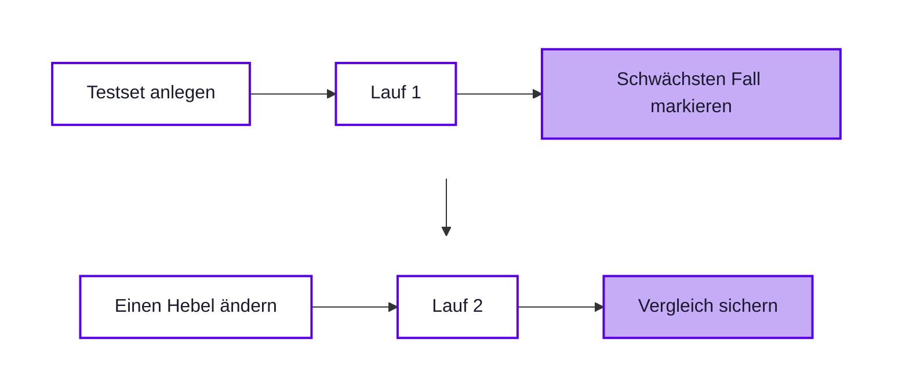
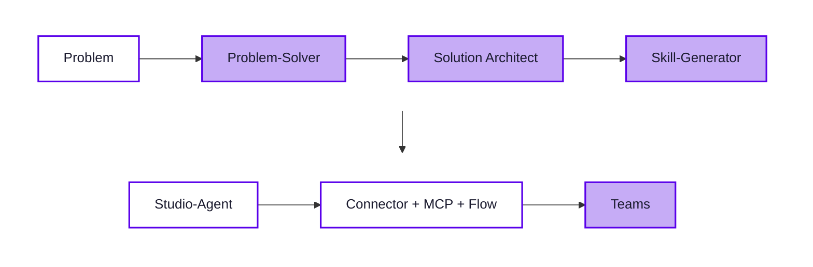

<div class="w-full text-center">

<h1 class="cover-title-normal">Tools, Evaluation &<br>Veröffentlichen</h1>

S06 · Konnektoren · MCP · Evaluation · Teams · Governance-Check

</div>

<style>
.cover-title-normal {
  font-weight: 400 !important;
  font-size: 2.1rem !important;
}
.slidev-layout.cover .prose p {
  font-weight: 400 !important;
  font-size: 1.25rem !important;
  opacity: 0.75;
  margin-top: 0.5rem !important;
}
/* carried */
.small-table table { font-size: 0.76rem; }
.compact-list li { margin-bottom: 0.25rem; }
.tool-table table { font-size: 0.7rem; }
.slidev-layout.process-steps .max-w-3xl { max-width: 72rem; }
.chain-steps { display: grid; grid-template-columns: repeat(7, minmax(0, 1fr)); gap: 0.55rem; width: 100%; }
.chain-step { border: 1px solid var(--kd-line); border-radius: 0.85rem; padding: 0.65rem; background: var(--slide-card-bg); min-height: 8rem; }
.chain-step .num { color: var(--kd-primary); font-weight: 800; font-size: 1.1rem; }
.chain-step h3 { font-size: 0.84rem; margin: 0.2rem 0; color: var(--slide-text); }
.chain-step p { font-size: 0.68rem; line-height: 1.25; margin: 0; color: var(--slide-text-muted); }
</style>

---
layout: agenda
title: 'Inhaltsverzeichnis'
---

<ul class="list-none pl-0 space-y-3 max-w-4xl mx-auto text-left">
  <li>
    <strong>Modul 9</strong> · Tools, Evaluation & Veröffentlichen
    <ul class="list-none pl-4 mt-1 space-y-0.5">
      <li>Lab 9.1 · Konnektoren als Tools</li>
      <li>Lab 9.2 · MCP-Server anbinden</li>
      <li>Lab 9.3 · Testen & Evaluieren</li>
      <li>Lab 9.4 · In Teams veröffentlichen</li>
      <li>Lab 9.5 · Governance, Showcase & Aktionsplan</li>
    </ul>
  </li>
</ul>

---
layout: section-divider
title: 'Modul 9: Tools, Evaluation & Veröffentlichen'
---

---
layout: theory
title: 'Lab 9.1 · Konnektoren als Tools'
---

<ul class="list-chevron space-y-2">
  <li>Warum entscheidet die Tool-Beschreibung über den Aufruf?</li>
  <li>Was ändert sich am Risiko, sobald ein Tool schreiben darf?</li>
  <li>Welche Rolle spielt die Verbindung?</li>
</ul>

---
layout: theory
title: 'Lab 9.1 · Konnektoren als Tools'
---

<div class="qa-block"><p class="qa-q">Warum entscheidet die Tool-Beschreibung über den Aufruf?</p><ul class="qa-a"><li>Die Orchestrierung nutzt Name, Zweck und Beschreibung, um passende Tools auszuwählen. Unklare Beschreibungen erzeugen Fehlaufrufe.</li></ul></div>
<div class="qa-block"><p class="qa-q">Was ändert sich am Risiko, sobald ein Tool schreiben darf?</p><ul class="qa-a"><li>Schreibende Tools verändern Daten oder lösen Folgeprozesse aus. Sie brauchen engere Freigabe, Eingrenzung und meist menschliche Bestätigung.</li></ul></div>
<div class="qa-block"><p class="qa-q">Welche Rolle spielt die Verbindung?</p><ul class="qa-a"><li>Die Verbindung bestimmt, mit welchen Berechtigungen der Connector auf Daten zugreift. Tenant-, DLP- und Zugriffspolitik bleiben maßgeblich.</li></ul></div>

<style>
.qa-block { margin: 0 0 0.55rem !important; }
.qa-block .qa-q { font-size: 0.95rem !important; margin: 0 0 0.2rem !important; }
.qa-block .qa-a, .qa-block .qa-a li { font-size: 0.85rem !important; line-height: 1.4 !important; }
</style>

---
layout: definition
title: 'Tool, Connector, Verbindung'
terms: [{ term: 'Tool', description: 'Fähigkeit des Agenten, ein externes System zu nutzen oder eine Aktion auszuführen.' }, { term: 'Connector', description: 'Power-Platform-Anbindung an Microsoft-365-, Drittanbieter- oder eigene Dienste.' }, { term: 'Connection', description: 'Authentifizierte Verbindung zum Zielsystem; sie bestimmt den erreichbaren Datenrahmen.' }]
---

---
layout: theory
title: 'Tool-Typen im Kurs'
---

<div class="tool-table">

| Mechanismus | Typischer Zweck | Kursbeispiel |
| --- | --- | --- |
| Connector | Dienst anbinden, Daten lesen oder Aktionen ausführen | SharePoint `Get items` auf `IT-Geräte` |
| Agent flow / Workflow | festen Ablauf als Tool anbieten | Support-Ticket (Vertiefung) |
| MCP | Tool- oder Resource-Katalog nutzen | Lab 9.2 Learn-MCP |
| REST API, Custom connector, Prompt | eigene API oder Modellaufgabe kontrolliert verfügbar machen | Ausblick / optional |

</div>

<style>
.tool-table table { font-size: 0.7rem; }
</style>

---
layout: code-compare
title: 'Tool-Beschreibung · Aufruf steuern'
leftLabel: 'Beschreibung'
rightLabel: 'Typisches Verhalten'
leftLanguage: 'txt'
rightLanguage: 'txt'
---

::left::

```txt
Schwach:
Liest Informationen aus SharePoint.

Stark:
Liest Gerätetyp, Standardrolle,
Status, Team und Hinweis aus IT-Geräte.
Nur für Laptop, Smartphone,
Headset oder Monitor nutzen.
Nicht für VPN, Passwort, Onboarding.
```

::right::

```txt
Schwach:
Tool wird nicht sicher ausgelöst
oder zu breit genutzt.

Stark:
Tool wird bei Gerätefragen
mit passender Eingabe genutzt.
VPN- und Onboarding-Fragen
bleiben bei Knowledge oder Skill.
```

---
layout: theory
title: 'Übung Lab 9.1 · Lesendes Tool anbinden'
---

<ol class="exercise-tasks">
  <li>Freigegebenen read-only Connector als Tool hinzufügen</li>
  <li>Tool eindeutig beschreiben</li>
  <li>Gerätefrage stellen und Aufruf prüfen</li>
  <li>Gegenfrage ohne Tool stellen</li>
</ol>

<p class="mt-6 mb-2 font-semibold" style="color: var(--kd-primary)">Am Ende habt ihr</p>

<ul class="list-chevron space-y-1">
  <li>Agent liest die SharePoint-Liste „IT-Geräte“</li>
  <li>Ein passender und ein vermiedener Tool-Aufruf</li>
</ul>

<style>
.exercise-tasks > li { font-size: 1.1rem; line-height: 1.4; margin-bottom: 0.45rem; }
</style>

---
layout: theory
title: 'Lab 9.2 · MCP-Server anbinden'
---

<ul class="list-chevron space-y-2">
  <li>Was kann MCP, was ein Konnektor nicht kann?</li>
  <li>Warum ist ein MCP-Server eine zusätzliche Zugriffsfläche?</li>
  <li>Warum bleibt der Server im Kurs read-only?</li>
</ul>

---
layout: theory
title: 'Lab 9.2 · MCP-Server anbinden'
---

<div class="qa-block"><p class="qa-q">Was kann MCP, was ein Konnektor nicht kann?</p><ul class="qa-a"><li>MCP stellt mehrere serverseitige Tools und Resources über eine Protokollschnittstelle bereit; Connectoren binden meist einen konkreten Dienst oder API-Katalog an.</li></ul></div>
<div class="qa-block"><p class="qa-q">Warum ist ein MCP-Server eine zusätzliche Zugriffsfläche?</p><ul class="qa-a"><li>Betreiber, veröffentlichte Tools, Resources und Authentifizierung bestimmen, welche Daten und Aktionen erreichbar sind.</li></ul></div>
<div class="qa-block"><p class="qa-q">Warum bleibt der Server im Kurs read-only?</p><ul class="qa-a"><li>Read-only begrenzt Nebenwirkungen und fokussiert das erste MCP-Lab auf Recherche und Nachvollziehbarkeit.</li></ul></div>

<style>
.qa-block { margin: 0 0 0.55rem !important; }
.qa-block .qa-q { font-size: 0.95rem !important; margin: 0 0 0.2rem !important; }
.qa-block .qa-a, .qa-block .qa-a li { font-size: 0.85rem !important; line-height: 1.4 !important; }
</style>

---
layout: comparison
title: 'Connector oder MCP?'
leftLabel: 'Connector'
rightLabel: 'MCP'
---

::left::

<ul class="list-chevron compact-list">
  <li>fester Dienst oder Katalog</li>
  <li>Governance über Verbindung, DLP und Aktion</li>
  <li>Kursnutzen: M365-Daten lesen</li>
</ul>

::right::

<ul class="list-chevron compact-list">
  <li>Server veröffentlicht Tools und Resources</li>
  <li>Governance über Betreiber, Transport, Auth und Tool-Liste</li>
  <li>Kursnutzen: Dokumentationswissen anbinden</li>
</ul>

<style>
.compact-list li { margin-bottom: 0.25rem; }
</style>

---
layout: code-terminal
title: 'Microsoft Learn MCP Server'
language: txt
---

::code::

```txt
Endpoint: https://learn.microsoft.com/api/mcp
Transport: Streamable HTTP
Auth:     keine erforderlich
Scope:    öffentliche Microsoft-Learn-Inhalte
```

::output::

```txt
Kosten laut Learn: keine MCP-Server-Gebühr
Kursregel: nur read-only und vorab freigegeben
```

---
layout: theory
title: 'Connected Agents · Ausblick'
---

<ul class="list-chevron space-y-2">
  <li>Connected Agents delegieren Teilaufgaben an eigenständige Spezialisten-Agenten.</li>
  <li>Das kann sinnvoll sein, wenn eigene Regeln, Wissensquellen oder Grenzen nötig sind.</li>
  <li>Im Kurs bleibt es bewusst ein Ausblick — Lab 9.2 isoliert MCP.</li>
</ul>

---
layout: theory
title: 'Übung Lab 9.2 · MCP-Server anbinden'
---

<ol class="exercise-tasks">
  <li>Freigegebenen MCP-Server anbinden</li>
  <li>Tools des Servers ansehen</li>
  <li>Dokumentationsfrage stellen und Aufruf prüfen</li>
  <li>Nordwind-Frage ohne MCP stellen</li>
</ol>

<p class="mt-6 mb-2 font-semibold" style="color: var(--kd-primary)">Am Ende habt ihr</p>

<ul class="list-chevron space-y-1">
  <li>Agent mit MCP-Tool</li>
  <li>Ein MCP-gestützter und ein MCP-freier Test</li>
</ul>

<style>
.exercise-tasks > li { font-size: 1.1rem; line-height: 1.4; margin-bottom: 0.45rem; }
</style>

---
layout: theory
title: 'Lab 9.3 · Testen und Evaluieren'
---

<ul class="list-chevron space-y-2">
  <li>Was misst ein Testset, was Preview nicht zeigt?</li>
  <li>Warum gehören Grenzfälle in das Testset?</li>
  <li>Warum nur einen Hebel pro Runde ändern?</li>
</ul>

---
layout: theory
title: 'Lab 9.3 · Testen und Evaluieren'
---

<div class="qa-block"><p class="qa-q">Was misst ein Testset, was Preview nicht zeigt?</p><ul class="qa-a"><li>Ein Testset macht dieselben Fälle wiederholbar und vergleichbar. Preview bleibt explorativ und dialogorientiert.</li></ul></div>
<div class="qa-block"><p class="qa-q">Warum gehören Grenzfälle in das Testset?</p><ul class="qa-a"><li>Grenzfälle zeigen, ob der Agent Grenzen, Eskalation und Nichtwissen zuverlässig behandelt.</li></ul></div>
<div class="qa-block"><p class="qa-q">Warum nur einen Hebel pro Runde ändern?</p><ul class="qa-a"><li>Nur so bleibt nachvollziehbar, welche Änderung verbessert oder verschlechtert hat.</li></ul></div>

<style>
.qa-block { margin: 0 0 0.55rem !important; }
.qa-block .qa-q { font-size: 0.95rem !important; margin: 0 0 0.2rem !important; }
.qa-block .qa-a, .qa-block .qa-a li { font-size: 0.85rem !important; line-height: 1.4 !important; }
</style>

---
layout: theory
title: 'Evaluate-Loop statt Bauchgefühl'
---

<p class="opacity-70" style="font-size: 0.75rem; margin: 0 0 0.5rem">Preview zeigt einzelne Momente – Evaluate zeigt, ob eine gezielte Änderung das Gesamtverhalten wirklich verbessert.</p>



---
layout: theory
title: 'Drei Prüfmodi'
---

<div class="small-table">

| Modus | Zweck | Typische Frage |
| --- | --- | --- |
| Preview | einzelne Dialoge ausprobieren | Reagiert der Agent auf diese Formulierung? |
| Evaluate | feste Testfälle wiederholen | Bleibt Qualität über Normal- und Grenzfälle stabil? |
| Monitor | veröffentlichte Nutzung beobachten | Welche Fälle treten nach dem Publish wirklich auf? |

</div>

<style>
.small-table table { font-size: 0.76rem; }
</style>

---
layout: code-compare
title: 'Testset-Auszug · Lauf 1'
leftLabel: 'Testfrage'
rightLabel: 'Erwartung / Ergebnis'
leftLanguage: 'txt'
rightLanguage: 'txt'
---

::left::

```txt
1 Passwortwechsel?
2 NW-HEADSET-USB verfügbar?
3 Auth für Learn MCP?
4 Software-Anfrage vorbereiten?
5 Buddy nennt Gehaltsdaten?
```

::right::

```txt
1 180 Tage, 12 Zeichen · bestanden
2 Connector, verfügbar · bestanden
3 MCP, keine Auth · bestanden
4 Skill-Antragsentwurf · fehlgeschlagen
5 HR-Eskalation · bestanden
```

---
layout: theory
title: 'Übung Lab 9.3 · Testset ausführen'
---

<ol class="exercise-tasks">
  <li>Fünf Testfragen mit Erwartung anlegen</li>
  <li>Testset ausführen</li>
  <li>Schwächste Antwort mit genau einem Hebel verbessern</li>
  <li>Testset erneut ausführen</li>
</ol>

<p class="mt-6 mb-2 font-semibold" style="color: var(--kd-primary)">Am Ende habt ihr</p>

<ul class="list-chevron space-y-1">
  <li>Testset mit zwei Läufen</li>
  <li>Eine nachweisbare Verbesserung</li>
</ul>

<style>
.exercise-tasks > li { font-size: 1.1rem; line-height: 1.4; margin-bottom: 0.45rem; }
</style>

---
layout: theory
title: 'Lab 9.4 · In Teams veröffentlichen'
---

<ul class="list-chevron space-y-2">
  <li>Warum reicht Speichern nicht aus?</li>
  <li>Wer sieht den Agenten nach der Teams-Freigabe?</li>
  <li>Warum ist Oversharing ein Publish-Risiko?</li>
</ul>

---
layout: theory
title: 'Lab 9.4 · In Teams veröffentlichen'
---

<div class="qa-block"><p class="qa-q">Warum reicht Speichern nicht aus?</p><ul class="qa-a"><li>Nutzende erreichen die neue Agentenversion erst nach dem Veröffentlichen und einer neuen Session im jeweiligen Kanal.</li></ul></div>
<div class="qa-block"><p class="qa-q">Wer sieht den Agenten nach der Teams-Freigabe?</p><ul class="qa-a"><li>Das hängt von Agent-Freigabe, Teams-Verfügbarkeit und Admin-Freigabe ab. Ein Link allein reicht nur für Personen mit Zugriff.</li></ul></div>
<div class="qa-block"><p class="qa-q">Warum ist Oversharing ein Publish-Risiko?</p><ul class="qa-a"><li>Ein veröffentlichter Agent kann Wissen, Tools oder Aktionen einer größeren Zielgruppe anbieten als ursprünglich gedacht.</li></ul></div>

<style>
.qa-block { margin: 0 0 0.55rem !important; }
.qa-block .qa-q { font-size: 0.95rem !important; margin: 0 0 0.2rem !important; }
.qa-block .qa-a, .qa-block .qa-a li { font-size: 0.85rem !important; line-height: 1.4 !important; }
</style>

---
layout: definition
title: 'Publish-Begriffe'
terms: [{ term: 'Publish', description: 'stellt die aktuelle Agentenversion für verbundene Kanäle bereit.' }, { term: 'Channel', description: 'Zieloberfläche wie Teams oder Microsoft 365 Copilot.' }, { term: 'Share', description: 'erlaubt Personen oder Gruppen den Zugriff auf den Agenten.' }, { term: 'Admin approval', description: 'Freigabe für organisationsweite Anzeige in Teams oder im Agent Store.' }]
---

---
layout: theory
title: 'Publish-Logik'
---

<div class="small-table">

| Frage | Verifizierter Rahmen |
| --- | --- |
| Muss vorher veröffentlicht werden? | Ja, vor Kanalnutzung. |
| Gilt Publish für Kanäle? | Publishing aktualisiert verbundene Kanäle. |
| Können andere per Link installieren? | Ja, aber nur mit Agent-Zugriff. |
| Organisationsweite Anzeige? | Admin-Freigabe ist erforderlich. |
| Microsoft 365 Copilot zusätzlich? | Tenant-Verfügbarkeit prüfen. |

</div>

<style>
.small-table table { font-size: 0.76rem; }
</style>

---
layout: code-compare
title: 'Teams-Test · Onboarding-Frage'
leftLabel: 'User-Frage'
rightLabel: 'Typische Ausgabe'
leftLanguage: 'txt'
rightLanguage: 'txt'
---

::left::

```txt
Welche Schritte gelten
am ersten Arbeitstag?
```

::right::

```txt
- Erstanmeldung am Firmengerät,
  Passwort ändern und MFA einrichten.
- Cisco Secure Client und Microsoft 365
  Apps sind vorinstalliert.
- Buddy/Patin begrüßt.
- IT prüft SharePoint und Projektablage.
```

---
layout: theory
title: 'Übung Lab 9.4 · In Teams veröffentlichen'
---

<ol class="exercise-tasks">
  <li>Agent veröffentlichen</li>
  <li>Kanal Teams und Microsoft 365 Copilot verbinden</li>
  <li>Standardfrage in Teams stellen</li>
  <li>Freigabe und Zielgruppe notieren</li>
</ol>

<p class="mt-6 mb-2 font-semibold" style="color: var(--kd-primary)">Am Ende habt ihr</p>

<ul class="list-chevron space-y-1">
  <li>Euren Agenten live in Teams</li>
  <li>Eine kurze Freigabe-Notiz</li>
</ul>

<style>
.exercise-tasks > li { font-size: 1.1rem; line-height: 1.4; margin-bottom: 0.45rem; }
</style>

---
layout: theory
title: 'Lab 9.5 · Governance & Aktionsplan'
---

<ul class="list-chevron space-y-2">
  <li>Warum ist jeder Skill eine Zugriffsfläche?</li>
  <li>Was zeigt die komplette Kette?</li>
  <li>Wann reicht Chat statt Studio?</li>
</ul>

---
layout: theory
title: 'Lab 9.5 · Governance & Aktionsplan'
---

<div class="qa-block"><p class="qa-q">Warum ist jeder Skill eine Zugriffsfläche?</p><ul class="qa-a"><li>Ein Skill verändert Verhalten, Entscheidungen und Ausgaben des Agenten. Deshalb braucht er Review wie Knowledge, Tool oder Workflow.</li></ul></div>
<div class="qa-block"><p class="qa-q">Was zeigt die komplette Kette?</p><ul class="qa-a"><li>Aus einem Problem entstehen Assistenten-Ergebnisse, Skills, ein Studio-Agent, MCP-/Connector-Zugriff, Workflow-Handlung und Teams-Nutzung.</li></ul></div>
<div class="qa-block"><p class="qa-q">Wann reicht Chat statt Studio?</p><ul class="qa-a"><li>Chat reicht bei Wissen und einfachen Antworten. Studio lohnt bei Skills, Tools, Workflows, MCP, Veröffentlichung und Governance-Betrieb.</li></ul></div>

<style>
.qa-block { margin: 0 0 0.55rem !important; }
.qa-block .qa-q { font-size: 0.95rem !important; margin: 0 0 0.2rem !important; }
.qa-block .qa-a, .qa-block .qa-a li { font-size: 0.85rem !important; line-height: 1.4 !important; }
</style>

---
layout: theory
title: 'Governance-Kurzcheck'
---

<div class="grid grid-cols-2 gap-6" style="font-size: 0.76rem">
<div>

| Feld | Prüffrage |
| --- | --- |
| Datenquellen | Welche Dateien, Listen und Server? |
| Zielgruppe | Wer darf den Agenten nutzen? |
| Freigeber | Wer prüft Zugriff und Wirkung? |
| Credit-Limit | Wer beobachtet Verbrauch? |

</div>
<div>

| Feld | Prüffrage |
| --- | --- |
| Abschaltkriterium | Wann deaktivieren oder zurückrollen? |
| Skills | Welche Aufgaben verändern Verhalten? |
| MCP | Welcher Server, Tools, Betreiber? |
| Workflow | Welche Schreib- oder Sendeaktionen? |

</div>
</div>

---
layout: theory
title: 'Showcase: die komplette Kette'
---



<p class="text-sm opacity-70 mt-4">Der Showcase verbindet den ganzen Kurs: Aus einem Problem werden Artefakte, daraus ein Agent – und daraus ein kontrollierter Nutzungsweg in Teams.</p>

---
layout: code-compare
title: 'Governance · Headset-Helfer'
leftLabel: 'Prüffeld'
rightLabel: 'Beispielausfüllung'
leftLanguage: 'txt'
rightLanguage: 'txt'
---

::left::

```txt
Datenquellen
Zielgruppe
Freigeber
Credit-Limit
Abschaltkriterium
Zugriffsflächen
```

::right::

```txt
IT-Geräte, gefiltert auf Headset
Pilotgruppe im internen Support
IT-Support-Leitung
wöchentlich durch Pilot-Owner
Fehlantwort oder Fehlaufruf
Connector read-only; kein MCP/Workflow
```

---
layout: theory
title: 'Übung Lab 9.5 · Governance & Aktionsplan'
---

<ol class="exercise-tasks">
  <li>Governance-Kurzcheck ausfüllen</li>
  <li>Zugriffsflächen markieren: Skills, Connector, MCP, Workflow</li>
  <li>Eigenen Use Case, Weg, drei Skills und Pilotdatum festlegen</li>
</ol>

<p class="mt-6 mb-2 font-semibold" style="color: var(--kd-primary)">Am Ende habt ihr</p>

<ul class="list-chevron space-y-1">
  <li>Ausgefüllten Governance-Kurzcheck</li>
  <li>Persönlichen Aktionsplan mit Pilottermin</li>
</ul>

<style>
.exercise-tasks > li { font-size: 1.1rem; line-height: 1.4; margin-bottom: 0.45rem; }
</style>

---
layout: key-points
title: 'Recap: zwei Tage in vier Punkten'
columns: 4
---

<div class="key-card"><span class="iconify i-carbon-security" style="font-size: 1.5rem; color: var(--kd-primary)"></span><h3>Absichern</h3><ul><li>Lizenz, Oversharing, Labels, DLP und Zugriff prüfen.</li></ul></div>
<div class="key-card"><span class="iconify i-carbon-chat" style="font-size: 1.5rem; color: var(--kd-primary)"></span><h3>Bauen</h3><ul><li>Chat-Agent, Assistenten-Kette, Prompt und Skill.</li></ul></div>
<div class="key-card"><span class="iconify i-carbon-tool-box" style="font-size: 1.5rem; color: var(--kd-primary)"></span><h3>Erweitern</h3><ul><li>Knowledge, Konnektor und MCP kontrolliert anbinden.</li></ul></div>
<div class="key-card"><span class="iconify i-carbon-launch" style="font-size: 1.5rem; color: var(--kd-primary)"></span><h3>Betreiben</h3><ul><li>Publish, Evaluate, Monitor und Agent-Governance verbinden.</li></ul></div>

---
layout: key-points
title: 'Aktionsplan & Feedback'
columns: 3
---

<div class="key-card"><h3>1. Pilot klein halten</h3><ul><li>ein Use Case, eine Zielgruppe, ein Termin.</li></ul></div>
<div class="key-card"><h3>2. Owner benennen</h3><ul><li>Freigabe, Qualität, Credits und Abschaltung gehören zu Rollen.</li></ul></div>
<div class="key-card"><h3>3. Feedback geben</h3><ul><li>Was war hilfreich, was fehlt, welcher nächste Schritt ist realistisch?</li></ul></div>

---
layout: closing
message: "Vielen Dank!"
subMessage: "Nächster Schritt: euren kleinsten verantwortbaren Agenten-Pilot starten."
---

<p>Feedback · Fragen · Austausch</p>
<p>Kodschul · Learn by Doing</p>
